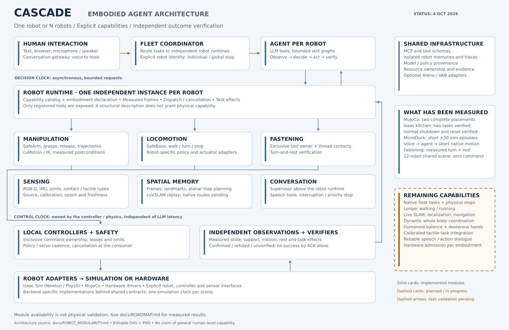

# CASCADE 🦾 — Cascaded Agentic Skill Control with Adaptive Dispatch and Execution

Run the whole cascade with no robot, GPU or credentials:

```bash
git clone https://github.com/johnnynunez/cascade.git && cd cascade
uv sync --extra dev --extra kinematics     # creates .venv; every `uv run` below uses it
uv run python -m cascade.apps.demo --task "pick and place the red object"
```

The mock jaws hold nothing, so the task report says `success: False` with the
postcondition refuted: the verifier at work. Real physics: the MuJoCo lines in
[Quick start](#quick-start).

CASCADE is a modular framework for agentic robotics. An LLM, or a chat host over
MCP, drives curated, safety-gated robot skills. Routine commands resolve through a
reflex grammar or learned habits before any LLM call, so robot control never waits
on model latency. Every motion skill reports a **confirmed, refuted or unverified
postcondition** from physics truth, perception or jaw width; a refuted claim
downgrades the skill's own `ok`. Profiles, drivers, cameras, compute and LLM
providers are replaceable. The reference deployment, a Seeed reBot DevArm B601
(RobStride build) driven from an NVIDIA DGX Spark, is one configuration it runs on.

<p align="center">
  <a href="https://github.com/johnnynunez/cascade/actions/workflows/ci.yml"></a>
  <a href="pyproject.toml"></a>
  <a href="LICENSE"></a>
  <a href="docs/ARCHITECTURE.md"></a>
</p>

[](docs/ROBOT_MODULARITY.md)

[Download PNG](docs/assets/architecture.png). Dashed boxes mark work still in progress.

## Pick your path

| you want to | start with |
|---|---|
| install the PAAI kitchen demo on a DGX Spark | [DGX Spark setup](docs/DGX_SPARK_SETUP.md): allow 30–90 min uncached plus cold CUDA builds; the September launch reached READY in ~12 min |
| present the demo at a booth (15-min sessions) | [presenter card](docs/BOOTH_RUNBOOK.md#9-simulated-kitchen-on-dgx-spark-presenter-card) |
| run the demo on a laptop (MuJoCo + OpenClaw chat) | `./run.sh mujoco --brain keep`, then [Quickstart](docs/QUICKSTART.md) |
| drive a real arm | [safety notes](#safety-notes-for-a-live-rig), then [Quickstart: reference rig](docs/QUICKSTART.md#3-reference-rig-rebot--isaac-sim-with-a-local-brain) |
| understand the runtime | [Architecture](docs/ARCHITECTURE.md), then [capability status](docs/ROADMAP.md) |

Beyond the tabletop arm (all opt-in; each doc states what is measured):

- [Composed robot runtime](docs/ROBOT_MODULARITY.md): manipulation, locomotion, fastening, sensor and spatial domains. Try `--robot mixed_mock`, or `--robot mobile_manipulator_mock` for the mock-only whole-body contract.
- [MicroDuck](docs/MICRODUCK.md) and the [Unitree H2](docs/HUMANOID_H2.md): legged bases on Newton / PhysX, simulation only, not physically admitted.
- [Conversation gateway](docs/CONVERSATION.md): browser audio, Realtime provider and a robot-tool allowlist with priority stop; it can run as its own process against `cascade-robot-service` ([protocol `cascade.robot-runtime/1`](docs/CONVERSATION.md#deploy-the-conversation-service-separately), [opt-in TLS](docs/CONVERSATION.md#across-hosts-opt-in-tls-b71) off loopback).
- [Spatial domain](docs/SPATIAL_PROVIDERS.md): capture-time frames, landmark memory, optional cuVSLAM (uncalibrated) and an opt-in `go_to` route runner with CPU tests only.
- Renderers, planners and hands: [OVRTX](docs/OVRTX_RENDERER.md), [cuMotion](docs/CUMOTION.md), [Factory fastening](docs/FACTORY_FASTENING_RUNTIME.md#thread-contact-fixture), [LEAP hand](docs/ROBOT_MODULARITY.md#fixed-leap-hand-leap_hand_right_mujoco).

## PAAI, Physical Agentic AI

PAAI is the **Build a Claw** event demo. Attendees use OpenClaw chat to inspect a
simulated kitchen and ask the arm to move prepared objects in NVIDIA Isaac Sim
6.1. Three camera views show the action; simulator physics readback checks the
result. The authenticated attendee page shows cameras; a separate `/staff/` page
explains prompts, result checks and recovery. Staff walkthrough:
[booth guide](docs/BOOTH_RUNBOOK.md#10-paai-on-brev-staff-guide).

## Roadmap

With the Sparks disconnected, source-bound validation continues on the local
dual-RTX Pro PC. Native proof and nvblox normal-campaign failures remain to be
resolved before five-object acceptance and the same-version restart. See [current status](docs/ROADMAP.md).

**Newton parity.** Installed Spark defaults to CUDA PhysX. Newton remains
explicit, with separate engine/asset validation.

**Cosmos 3 Edge.** Adoption follows when native tool calling through OpenClaw
passes attendee evaluation. Until then, Qwen remains the event path.

Optional **ovrtx** RGBD now runs on x86 and ARM with separate rendering evidence;
it is not included in the historical `477c88f` runtime baseline. Automatic
physics producers remain future work. Jev/Kev remains
offline decision research.

## Brev deployment

1. Create the instance: `brev create <name> --type g7e.2xlarge --flex-ports` (one RTX PRO 6000 Blackwell, 96 GB VRAM, 8 vCPUs, 62 GiB RAM, 1.7 TB NVMe); verify the NVMe mount after boot.
2. Prepare the source/asset bundle and site profile with [the deployment instructions](docs/BREV.md).
3. Run `./deploy/brev/deploy.sh preflight --profile /srv/cascade/site.json`, then the same with `install`.

`install` prepares and starts the demo (Isaac Sim 6.1 / CUDA PhysX, Qwen3.8-27B
**Q8_0** fully on the GPU); `start`, `status`, `restart` and `stop` take the same
`--profile`. Put heavy data under `/opt/dlami/nvme/paai-demo`. Bridge containers
failing on a missing `docker0`: `sudo systemctl restart docker`. Brev SSH relay
dropped: Tailscale to the VM's own SSH server works.

## Install

On a DGX Spark, run the one pinned command in [DGX Spark setup](docs/DGX_SPARK_SETUP.md#2-install)
(Isaac Sim 6.1, real GraspGen-X, Qwen Q4 with vision, OpenClaw, verified kitchen
assets), then `python3 scripts/desktop.py launch --repo "$PWD"`. READY requires two
native OpenClaw orders (green cube to green square, orange to open box), each with
a verified reset; logs stay under `runs/.install/` and `runs/.launch/profile-cascade-demo/`.

For development, list every extra you need in one `uv sync` (it removes the ones
you leave out, and also the packages `scripts/setup_env.sh` added), e.g.
`uv sync --extra dev --extra kinematics --extra sim --extra grasping`;
`uv run --extra sim ...` installs one extra, which stays in `.venv` until the next `uv sync`:

| extra | brings | when |
|---|---|---|
| `kinematics` | `pin` (Pinocchio) | always: FK/IK back the safety layer |
| `perception` | `ultralytics`, `openai` | real cameras: SAM 2.1-L masks + the brain client that names objects |
| `llm` | `openai`, `anthropic` | any real brain over an API (`codex_astra` needs only the Codex CLI) |
| `sim` / `sim-warp` | `mujoco` / `mujoco-warp`, `warp-lang` | hardware-free physics; the same MJCF on MuJoCo Warp (`engine: warp`) |
| `arm` / `arm-feetech` | `motorbridge` / `pyserial` | RobStride over SocketCAN / Feetech-servo arms (SO-101) |
| `grasping` | `pyzmq`, `msgpack-numpy` | the GraspGen-X / HUG / nvblox **client** wire (models run in their own venvs); without it the default `graspgenx` backend falls back to the analytic OBB planner on every grasp |
| `vla` | `websockets`, `msgpack` | the opt-in VLA policy client ([VLA executor](docs/VLA_EXECUTOR.md)) |

torch is deliberately not a dependency: install your platform's build and
[`cascade/device.py`](src/cascade/device.py) finds it. Robot meshes come from a
pinned upstream commit (`uv run python scripts/fetch_robot_assets.py --list`; `so101` is
~17 MB). Optional: `./scripts/install_hermes.sh --portal` (Hermes host and
robot registration); `bash scripts/install.sh --profile laptop --brain keep
--prepare-only --dir "$PWD"` (CPU/laptop prep, never installs Isaac or Cosmos).

## One click

```bash
./run.sh                 # Isaac Sim if installed (ISAACSIM_PATH or a standard path), else MuJoCo
./run.sh mujoco --brain keep  # keep an already authenticated OpenClaw brain
./run.sh check isaac     # read-only preflight: lists what is missing, starts nothing
./run.sh down            # stop everything it started, incl. orphaned per-session MCP servers
./run.sh isaac --headless --no-open   # extra flags pass through to scripts/launch.sh
```

`run.sh` wraps `scripts/launch.sh [--setup] --sim <mode>`. Before READY it:

1. builds the robot runtime once with the exact environment the MCP server gets;
2. lists the tools through OpenClaw and gets a trivial brain answer;
3. in sim modes, runs a physical order and a reset in one chat session (Spark: green cube and orange; generic Isaac: pink cube; MuJoCo: red cube);
4. writes `proof.json`, binding model, session and MCP runtime to the physical result and the reset.

`--no-robot-turn` reports **STARTED / UNVERIFIED**, never READY. `--judge
fake|vlm|grm` (or `CASCADE_JUDGE`, off by default) adds an advisory outcome judge
whose confusion matrix lands in `<proof evidence>/run-summary.json`; it never
changes READY. Every chat-host tool call is logged to `runs/mcp_<pid>/server.log`.

## Quick start

```bash
# SO-101 (5 DoF) on the mock stack; mock_small fits its 55 mm jaw
uv run python -m cascade.apps.demo --arm so101_mock --camera mock_small --task "pick and place the red object"
# real physics, no robot or GPU: postcondition channel = physics; add mujoco_wrist for a wrist camera
uv run python scripts/fetch_robot_assets.py so101
uv run --extra sim python -m cascade.apps.demo --arm so101_mujoco --cameras mujoco_scene,mujoco_wrist --interactive
# two arms; another robot; any ROS2 robot (sourced ROS2 env + ros2_control bringup)
uv run python -m cascade.apps.demo --arms so101_left,so101_right --camera mock_small --interactive
uv run python -m cascade.apps.demo --arm piper_mock --camera mock_small --task "pick and place the red object"
uv run python -m cascade.apps.demo --arm so101_ros2
# one click through OpenClaw; --sim none for a real arm; --dry-run prints the plan
./scripts/launch.sh --sim none --arm rebot_rs --cameras l515
# learned grasps (CUDA server warms up ~20 s before opening :5556) or the analytic stub (NOT the model)
scripts/serve_graspgenx.sh                 # or: uv run --extra grasping python scripts/serve_graspgenx_stub.py
./scripts/serve_occupancy.sh               # occupancy bridge :5557, auto: nvblox > warp > voxel
# real rig (rig packages: see Setup notes): CAN up, then N cameras (first = manipulation camera)
sudo ip link set can0 up type can bitrate 1000000
uv run python -m cascade.apps.demo --interactive --cameras d455f,uvc4k --arm rebot_rs --llm anthropic
# chat hosts instead of the CLI loop
./scripts/hermes_demo.sh                # Hermes: register + test + chat
./scripts/openclaw_demo.sh              # OpenClaw, local-brain variant (Cosmos3-Edge / Qwen servers)
# tests (live-hardware tests deselected; -m hardware needs a RealSense l515 + can0 up, read-only)
uv run python -m pytest tests/ -q
```

`--llm` defaults to `auto`: a logged-in Codex CLI (`codex_astra`), then Hermes
(`NOUS_API_KEY`), Anthropic, OpenAI, else the offline mock. `CASCADE_LLM`
overrides every invocation. More commands (Isaac, local brains, cameras):
[Quickstart](docs/QUICKSTART.md).

## What it runs on

An arm driver subclasses [`ArmBase`](src/cascade/control/arm_base.py) and reads a
YAML profile in [`configs/arms/`](configs/arms/): joint count, home poses, tool
frame, reach and gripper travel come from the profile, not the code.

| profiles | robot | transport | status |
|---|---|---|---|
| `rebot_rs` / `rebot_rs_mb` / `isaac` | Seeed reBot B601 (RobStride), 6 DoF | SocketCAN / MotorBridge / Isaac ZMQ bridge | reference rig |
| `rebot_rs_reach` / `isaac_reach` / `mock_reach` | reBot + the measured [reach envelope](docs/REACH_ENVELOPE.md) | as the parent | opt-in, kinematic only |
| `so101`, `so101_mujoco`, `so101_mjwarp`, `so101_mock`, `so101_ros2`, `so101_left`/`_right` | SO-101, 5 DoF | Feetech serial / MuJoCo / ROS2 | serial and ROS2 **untested on hardware** |
| `piper`, `h1`, `h1_2`, `g1`, `fr3` (+ `_mock` / `_mujoco` / `_sdk` variants) | AgileX PiPER, Unitree arms on a standing robot, Franka FR3 | ROS2 / Unitree SDK | **untested on hardware**; FR3 has a [hardware workflow](docs/FRANKA_OPENCLAW.md) |
| `h2_velocity_physx` (base profile) | Unitree H2 whole body, PhysX ([design](docs/HUMANOID_H2.md)) | Isaac Sim 6.2 owner (`scripts/isaac_h2_bridge.py`) | candidate: binding gate passed in simulation, no physical admission |
| `libero_panda`, `mock`, `ros2_generic` | Franka Panda in LIBERO; kinematic stand-in; **template** for any `ros2_control` robot | benchmark harness; none; ROS2 | template: copy, fill in, drop `template: true` |

- **Any ROS2 robot without Python:** `type: ros2` speaks `JointState` in and `FollowJointTrajectory` (or `JointTrajectory` / `Float64MultiArray`) out, joints by name.
- **Franka FR3:** STOP is latched at start; **Resume & Home** (`POST /resume`) clears it and returns to the taught overview `home_q`; `return_home_after_motion: true` returns there after success or an ordinary failed grasp. Record native state without commanding (subscribe-only), after sourcing ROS and the Franka workspace (`source /opt/ros/jazzy/setup.bash` and the workspace's `install/setup.bash`): `ROS_DOMAIN_ID=31 .venv-hardware/bin/python scripts/record_franka_motion.py --output <new.jsonl> --rate 100 [--duration <s>]` (the rig's ROS-capable venv, as in [Franka OpenClaw](docs/FRANKA_OPENCLAW.md)).
- <a id="multi-arm"></a>**Multi-arm:** `--arms a,b` builds an `ArmRig` (first = manipulation arm); motion skills take `arm="<name>"`. Each arm keeps its own `SafetyHarness`; with `base_pose` on both, link capsules (`safety.link_radii_m`) are gated by `safety.neighbor_clearance_m`. A wrong `base_pose` makes the distance confidently wrong: measure your table. A standby LazyArm neighbour (under the MCP server: before its first motion and after `move_to_rest`) cannot be read, so the gate SKIPs it instead of blocking and the arms are unprotected for that window; before two real arms move, connect both (the CLI default) ([`so101_left.yaml` header](configs/arms/so101_left.yaml#L38-L45)).
- **Gripper sweep:** an arm whose gripper differs from the reBot's 90 mm jaw must override `grasp.graspgenx.sweep` (see [`configs/arms/so101.yaml`](configs/arms/so101.yaml), 55 mm), or grasps come back too wide to close.
- **Compute:** `device: auto` probes CUDA/ROCm → Apple MPS → CPU and degrades with a warning; `CASCADE_DEVICE=cpu` forces CPU. The mock and MuJoCo stacks import no accelerator library. `so101_mjwarp` runs the same MJCF on MuJoCo Warp (~650× slower than the C engine on CPU).

Mobility is a separate opt-in layer (`--base <profile>`); ROS2 still drives arms
only and no hardware base exists. Code paths and evidence:
[Architecture → ROS2, humanoids, and what is NOT here yet](docs/ARCHITECTURE.md#ros2-humanoids-and-what-is-not-here-yet).

## LLM backends

| profile | backend | notes |
|---|---|---|
| `codex_astra` | GPT-6-Astra through the Codex CLI (`codex exec`, no API key) | picked first by `--llm auto` after `codex login`; vision + tools |
| `hermes` | [Hermes / Nous Portal](https://hermes-agent.nousresearch.com/) | `NOUS_API_KEY`; text only |
| `anthropic` / `openai` | Claude / any OpenAI-compatible cloud endpoint | `ANTHROPIC_API_KEY` / `OPENAI_API_KEY` |
| `local_qwen` | Qwen3.8-27B via `scripts/serve_qwen_llamacpp.sh` or `serve_qwen_vllm.sh` (:8080) | `model:` must be one of `serve_qwen_vllm.sh`'s served names |
| `local_cosmos` / `local_cosmos_sglang` | Cosmos3-Edge via vLLM (:8082) / SGLang (:8083, **unverified**) | `type: cosmos3` (XML tool calls) |
| `mock` | scripted | tests and wiring checks |

## Run it under any MCP agent platform

`cascade/apps/mcp_server.py` exposes the skill runtime over MCP: the same 42
safety-gated skills (only the loop-internal `task_done` is excluded), eight
gateway extras (`camera_snapshot`, `world_state`, `live_view_url`,
`robot_knowledge`, `verify_last_action`, `task_memory`, `emergency_stop`,
`reset_stop`) and, only with the opt-in [programs tier](docs/PROGRAMS_TIER.md#mcp-chat-hosts),
`list_programs` and `run_program`: 52 tools total (50 with the programs tier off,
its default). The capability matrix withholds what the built rig cannot run (the
default single-arm mock rig lists 49: `list_arms` needs two arms), with reasons in
`world_state.tools_withheld`. Re-derive with `openclaw mcp probe cascade --json`.

| host | register |
|---|---|
| **OpenClaw** | `./scripts/launch.sh` (on Linux the agent runs in [OpenShell](docs/OPENSHELL.md#every-linux-launch-scriptslaunchsh)), `./scripts/bootstrap.sh` (fresh Spark) or `./scripts/openclaw_demo.sh`; OpenClaw blocks `PYTHONPATH`, so cascade must be editable-installed in the venv (`uv sync` and these scripts do it) |
| **Hermes** *(default)* | `./scripts/install_hermes.sh --portal`, then `./scripts/hermes_demo.sh` |
| **Claude Code / Desktop** | project `.mcp.json`; `uv run python scripts/setup_agents.py --host claude --camera isaac,isaac_side --arm isaac --python "$PWD/.venv/bin/python" --write` (the entry stores that interpreter path; the default is `<checkout-parent>/.demo/bin/python`) |
| **Codex CLI** | `uv run python scripts/setup_agents.py --host codex --python "$PWD/.venv/bin/python" --write`, then check with `codex mcp list` (add `--codex-profile robot` for a layer only `codex -p robot` loads; list it with `codex -p robot mcp list`) |

- **Host vs brain:** as a host the platform's LLM picks tools and cascade's reflex/habit tiers are bypassed (`mcp_server.py` pins `llm='mock'`); as a brain (`--llm ...`) cascade runs its own loop with all tiers.
- **Registration env:** every runtime switch set in the registering shell is copied into the host's entry from one list, `src/cascade/apps/mcp_env.py`; rig selectors (`CASCADE_ROBOT`, `CASCADE_BASE`, `CASCADE_ARMS`) and secrets (`CASCADE_MCP_TOKEN`) never are. `--env KEY=VALUE` overrides.
- **Stopping never queues:** `emergency_stop` is handled out of band, a host cancel mid-motion freezes the arm, the first Ctrl+C latches the e-stop, and the dashboard STOP works from any LAN browser. `CASCADE_HIDE_TOOLS=reset_stop` makes clearing a stop staff-only.
- **Read-only lane (opt-in):** `mcp.readonly_lane: true` or `CASCADE_MCP_READONLY_LANE=1` lets `world_state`, `robot_knowledge`, `verify_last_action` and `camera_snapshot` answer during a motion (`served_during_motion`).
- **Env knobs:** `CASCADE_CAMERAS` / `CASCADE_ARMS` (comma lists, first = manipulation), `CASCADE_PERCEPTION_URL` / `_MODEL` / `_KEY_FILE`, `CASCADE_BRIDGE_PORT` / `CASCADE_GRASPGENX_PORT` / `CASCADE_OCCUPANCY_PORT` (8611 / 5556 / 5557). Full table: [Architecture → Launch and hosts](docs/ARCHITECTURE.md#launch-and-hosts).

## The 42 skills

One schema source (`TOOL_SPECS` in `src/cascade/skills/runtime.py`) feeds the
orchestrator, the LLM backends and the MCP server. The 24 skills in
`_MOTION_SKILLS` ("moves arm") pause `WorldWatcher` belief fusion and record a
memory frame + verdict. Every result carries `outcome: ok | failed | stuck`;
`stuck` (always `ok: false`) carries an `ask` for the human, relayed without retry.

| skill | what it does |
|---|---|
| `get_observation` | Fresh camera capture and tracking update. MCP returns the image, frame freshness, configured destinations and robot state; use `localize_object` for measured object positions |
| `describe_scene` | Fresh scene observation without motion. MCP returns an image and scene metadata for visual inspection; configured destinations do not establish visibility or occupancy |
| `localize_object` | Localize a named object from camera depth: base-frame position and size in meters. Configured-zone names return their configured XY center, with configuration provenance |
| `list_objects` / `count_objects` | Tracked and remembered objects with position and age (labels tentative) / a filtered count |
| `analyze_scene` / `annotated_view` | Per-camera detections and depth quality / a fresh image with numbered objects and a 5 cm grid |
| `probe_point` / `locate_pixel` | Pixel → depth, 3D position, nearby object, workspace membership / tracked object → pixel |
| `preview_grasp` | Plan a grasp and report the waypoint **without** moving |
| `open_live_view` / `close_live_view` / `live_view_status` | Browser dashboard (closed by default) |
| `recall_memory` | Recent events (~15 s), where a named object was last seen (opt-in `looks_like` with a `memory.embedder`) |
| `recall_step` | One executed step by index (`n`, negative = from the end): skill, args, outcome/ask, verdict, tier and BEFORE/AFTER keyframes (images over MCP); an invalid `n` is an explicit error |
| `list_arms` / `snapshot_scene` | Arm names of a multi-arm rig / memorize the layout as ADVISORY belief data |

**Moves the arm:**

- **Grasp and place:** `grasp_object` (localize → plan → approach → material-aware close → lift → verify), `grasp_at_pixel`, `pick_and_place`, `place_at`, `place_on_object`, `push_object`, `open_gripper` / `close_gripper`.
- **Small moves** ([spatial commands](docs/SPATIAL_COMMANDS.md)): `move_relative` (robot / screen / gripper frame, "a bit" = 2 cm, max 15 cm), `undo_move` (last 1-5 nudges), `rotate_joint` (≤ 90°), `rotate_gripper` (≤ 30°, wrist camera stays on top), `move_near_object`, `halt_motion` (stops the in-flight motion).
- **Poses:** `move_home` = the raised ready pose (`home_q`, motors on). `move_to_rest` = "home", "pose 0", "park": fold onto `park_q`, verify by measurement, close the gripper, motors off; refuses while holding or e-stopped and keeps the motors on if not measured at rest ([initial vs rest](docs/SPATIAL_COMMANDS.md#initial-pose-vs-rest-pose-home-pose-0-and-powering-off)).
- **Gestures:** `point_at`, `wave`, `handover` (holds until `open_gripper`), `sort_by_color`, `throw`; `turn_screw` commands wrist-roll strokes (thread advancement and torque not verified).
- **Scene:** `restore_scene` (displaced objects back, blocker-first), `search_for_object` (lift the largest occluder, re-perceive, resume the original task), `reset_scene` (arm home, props to spawn, world model and task memory cleared).

`task_done` is the 43rd spec and loop-internal, so MCP hosts never see it.

## Safety notes for a live rig

- The safety harness fails closed; motions abort mid-stream on violation.
- Hand-eye extrinsics in camera profiles are placeholders. Calibrate on site with `scripts/calibrate_handeye.py` (ArUco, or `--method markerless` for eye-to-hand RGB-D; [procedure](docs/HANDEYE_CALIBRATION.md)) and point `extrinsics.hand_eye_json` at the record; a missing, rejected or other-serial record leaves that camera without 3D fusion. Opt-in `extrinsics.drift_monitor` turns a knocked camera's fusion off and never moves the arm.
- The **top-down envelope** is small: below z ≈ 0.15 m on the B601-RS; on the SO-101 an annulus r ≈ 0.12–0.28 m under a hard z ≈ 0.09 m ceiling (`configs/arms/so101.yaml`).
- **reBot B601:** `configs/arms/rebot_rs.yaml` gripper travel (0 → +6.39 rad, closed at 0) disagrees with Seeed's WRC angle↔width scale: re-verify jaw width and stall before the first grasp ([onsite checks](docs/WRC_CONTROL_PORT.md)). Never run `motorbridge-gateway` / MotorBridge Studio during the demo (CAN host-id 0xFD conflict).
- **SO-101 (`--arm so101`): the serial driver has never run on hardware.** Before the first motion:
  1. `uv run --extra arm-feetech python scripts/diag_so101.py --port <port>`: read-only scan of ids, angles, voltage, temperature.
  2. `uv run --extra arm-feetech python scripts/diag_so101.py --port <port> --jog 1`: moves one joint a few degrees and names the `wire_signs` entry to flip.
  3. Re-measure the gripper travel and set `gripper.*`.
  4. Park with `move_home` before disconnecting: `disconnect()` cuts torque and a loaded arm drops.

## Setup notes

Only for a real or Isaac camera. `PY="$PWD/.venv/bin/python" bash scripts/setup_env.sh`
adds the rig packages (ultralytics, openai, anthropic, motorbridge) to the `uv sync`
venv (without `PY` it targets the reference rig's own venv); pyrealsense2 comes from the
[librealsense fork](https://github.com/johnnynunez/librealsense). The local
**Qwen3.8-27B** brain names objects (`detector: type: brain`) and **SAM 2.1-L**
masks its boxes ([bake-off evidence](docs/evidence/perception-bakeoff-20261015/REPORT.md)):

1. Brain endpoint: `CASCADE_PERCEPTION_URL` (default `http://127.0.0.1:8080/v1`, where `scripts/serve_qwen_*.sh` listen), `CASCADE_PERCEPTION_MODEL` (`qwen3.8-27b`), `CASCADE_PERCEPTION_KEY_FILE` (`~/.cascade/nemoclaw/llama.key`; the path is forwarded, never the key). `launch.sh --brain qwen` and OpenShell instances saved with the Qwen brain set them (the rig's instance uses its own brain on :8081).
2. SAM weights: `models/sam2.1_l.pt` (~450 MB), placed by `scripts/install.sh --profile spark`, named by absolute path in `configs/demo.yaml`; ultralytics runs offline and never downloads it. Missing file: boxes without masks (`scripts/booth_up.sh` warns).
3. The watcher never waits for the brain: SAM tracks cached boxes while the brain refreshes them in the background. Brain down: known objects stay tracked while the scene is unchanged; nothing new is named.
4. "Find the X" asks the brain directly (~2 s), then SAM masks the answer.

## Docs

- [Documentation index](docs/README.md) · [capability status](docs/ROADMAP.md) · [Quickstart](docs/QUICKSTART.md) · [DGX Spark setup](docs/DGX_SPARK_SETUP.md) · [Booth runbook](docs/BOOTH_RUNBOOK.md) · [Chrome / Firefox camera companion](docs/CHROME_EXTENSION.md)
- [Architecture](docs/ARCHITECTURE.md): tiers, the `execute()` choke point, verification channels, module map; also [lazy frame encoding](docs/ARCHITECTURE.md#lazy-frame-encoding) and [Isaac bridge profiling](docs/ARCHITECTURE.md#optional-bridge-timing).
- [AGENTS.md](AGENTS.md): working guide for AI coding agents.

## Naming note

The repo, Python package, CLI entry points (`cascade`, `cascade-record`,
`cascade-mcp`, `cascade-view`) and env prefix (`CASCADE_*`) are all **cascade**,
renamed from `wrc_demo` / `WRC_*`. With an older checkout, re-run
`scripts/setup_agents.py` for host registrations and copy `~/.wrc_demo/*` to
`~/.cascade/`.
