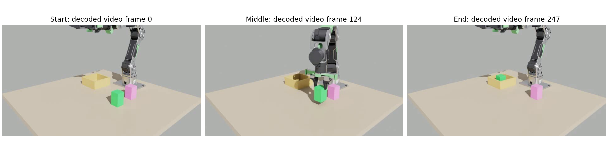
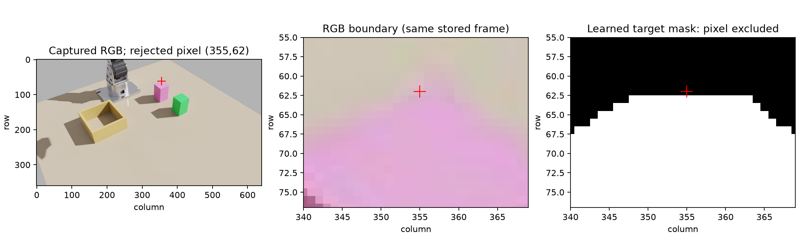

# Optional OVRTX renderer

**Next action:** install the SDK in its own venv and run the analytic RGB-D smoke (up to 3 min; a
cold shader cache can take longer and then fails the run):

```bash
python3.12 -m venv .venv-ovrtx312
.venv-ovrtx312/bin/python -m pip install -e '.[ovrtx]' pillow
timeout --signal=TERM --kill-after=5s 180s \
  .venv-ovrtx312/bin/python benchmark/diagnostics/ovrtx_rgbd_smoke.py \
  --device 0 --output /tmp/cascade-ovrtx-smoke-new
```

Use Python 3.10–3.13 on an RTX-capable host (the SDK does not support 3.14; wheels, driver
requirements and license terms are in the [official repository](https://github.com/NVIDIA-Omniverse/ovrtx)).
The output directory must not exist. The smoke renders four RGB-D packets of its own cube scene
(two cameras, distinct focal lengths, a parent transform, rotated object and moved camera), saves
NPZ/PNG files and a receipt, compares depth with analytic ray/box intersections and checks
whole-packet duplicate retention. The timeout belongs to the isolated process because native shader
compilation cannot be interrupted by a Python thread deadline.

Cascade's opt-in `ovrtx` adapter produces real RTX RGB and metric depth through NVIDIA OVRTX 0.5
and `ovstage` without starting Kit or selecting a physics engine; Isaac, MuJoCo, hardware and
desktop defaults are unchanged. Entry points:

1. `make_camera(load_profile("cameras", "ovrtx"))`: the static example USD scene through
   `CameraBase` ([configs/cameras/ovrtx.yaml](../configs/cameras/ovrtx.yaml), viewing-only).
2. `OvrtxRenderer.render(SceneSnapshot(...))`: a caller-provided scene and camera pose sample in,
   complete `Frame`s out (an integration API, not an automatic Isaac or Newton producer); it can
   return semantic body masks for an explicit geometry inventory.
3. `CASCADE_CAMERA_RENDERER=ovrtx`: the live Isaac producer below.

Rendering never steps physics or infers attachment; joint and contact measurements belong to the
physics producer.

## Live manipulation selection

```bash
export CASCADE_CAMERA_RENDERER=ovrtx
export CASCADE_OVRTX_PYTHON=/absolute/path/to/ovrtx-env/bin/python
export CASCADE_OVRTX_OUTPUT=/absolute/path/to/new-run/render
export CASCADE_OVRTX_DEVICE=0  # CUDA-visible ordinal, same device visibility as Isaac
./run.sh isaac
```

Bridge equivalents: `--camera-renderer ovrtx`, `--ovrtx-python`, `--ovrtx-output`,
`--ovrtx-device`. The normal Isaac camera profiles stay selected, so `BridgeClient.observation()`
and `IsaacArm.state_from_frame()` consume the existing atomic frame contract.

1. `scripts/isaac_ovrtx.py` exports a private flattened, metre-authored Z-up USD and a scene
   manifest; every physics rigid body (nested links and fingers included) gets its captured tensor
   pose, and the wrist optical transform derives from the captured wrist body and calibrated mount.
   Exported geometry is static (runtime additions, removals or deformables need a new owner).
2. Kit only reads and flattens its stage; all render-only USD edits happen in the child process
   (editing a matching stage inside Kit invalidated the live physics view in the first native
   trial).
3. The SDK runs in a separately owned process over a private socket: one outstanding request, no
   backlog; shutdown, render errors and deadlines close the child; a partial transaction never
   yields a fresh-looking packet; the renderer is rebuilt across physics epochs.
4. RGB, optical Z depth and body segmentation come from one sensor frame (labels encode
   case-sensitive USD paths). Masks combine with captured contact state only when that channel is
   available; otherwise the mask reports an explicit error.
5. `render_reference.source=ovrtx_snapshot` binds the scene-state digest, captured joints, physics
   step/epoch/time and renderer ordinal/sensor interval (never presented as `rpFabricTime`);
   readiness and held-object guards keep their clock, identity, age and measured-joint checks.

Dynamic smoke: `benchmark/diagnostics/ovrtx_runtime_smoke.py --python <SDK-python> --output
<new-directory>` (2 October, RTX PRO 6000, SDK 0.5: target mask 2,196 → 3,140 px and median depth
1.85 → 1.60 m for a 0.25 m translation; synthetic physical state, not a manipulation claim).

## Native manipulation acceptance — 2 October 2026

One normal `pick_and_place("green object")` completed with live OVRTX cameras (cam0 and side at
640×360), cuMotion planning, SafeArm execution and GPU PhysX at source
`f2b2186317a6eb6278bf7a57bf039c912e64dc18`, real GraspGenX required and the observed-finger gate on
([receipt](../benchmark/results/ovrtx-runtime-manipulation-20261002.json)).

1. Eight task curves (529 targets) plus the automatic park (60) passed the runtime checks; closing,
   contact stability (0.482 mrad over 0.5 s against 0.5 mrad), lift, transport, release and home
   completed in 126.19 s under concurrent GPU use (not a performance figure).
2. Post-task: 24 advancing samples with open jaws and a stationary object, final centre 23.51 mm
   from the drop-zone centre, unchanged after park; support evidence is pose and height, not a
   measured reaction force.
3. Failed attempts are retained: pink native03 (observed-finger guard rejected a border pixel; no
   lift), green native03 (home sweep would cross pink; gate rejected it), green native04 (contact
   window deadline; no lift).
4. No target-mask inflation, ground-truth contact exemption or object-pose write was used;
   occupancy was disabled in the isolated fixture.
5. Scope: x86_64 RTX PRO 6000 and the two-prop PhysX scene; not Newton, kitchen trial 12, real
   hardware, ARM manipulation or end-to-end nvblox.





## Device and static profile

`device` is a **CUDA-visible ordinal**, independent of the physics device: for a chosen GPU set
`CUDA_VISIBLE_DEVICES` to its UUID and use `--device 0`. The x86 validation saw rendering on the
selected GPU plus an 8 MiB graphics context on the other (not exclusive use). Static profile, from
the repository root:

```python
from cascade.config import load_profile
from cascade.perception.camera_base import make_camera

with make_camera(load_profile("cameras", "ovrtx")) as camera:
    frame = camera.get_frame()
    print(frame.rgb.shape, frame.depth_m.shape, frame.K)
```

Portable runtime bundles include the profile, its USD example and both adapter modules (assembly
refuses missing members) but not the SDK. The first capture creates the renderer in the capture
thread; `close()` releases everything (`keep_system_alive=False`); a failed init or partial frame
invalidates the owner, so construct a new one. `static_scene: true` is mandatory, so the visual
motion verifier abstains.

## Frame and snapshot contract

1. `Frame.rgb` is BGR `uint8`; `Frame.depth_m` is aligned `float32` optical **Z in metres**
   (`DistanceToImagePlaneSD`); background, non-finite and clipped depth is zero; no inferred depth.
2. Camera: centered, undistorted, square-pixel pinhole. `fx == fy` is required (the SDK ignored
   unequal focal lengths); principal point `cx=(width-1)/2`, `cy=(height-1)/2`; off-center requests
   are rejected. `T_base_cam` maps optical (+X right, +Y down, +Z forward) to the scene frame.
   Geometry and translations must be authored in metres.
3. Each `SceneSnapshot` contains every configured dynamic prim as **local parent-to-prim**
   transforms (cameras in the scene frame), captured under the physics owner's lock as one coherent
   sample. Source/epoch are fixed per owner; sequence, sim time and capture time (host monotonic,
   before rendering) must advance. An identical sequence returns a copy of the **whole previous
   packet**; a contradictory duplicate or regressing clock is rejected before stage writes.
4. RGB and depth come from one camera frame after the same renderer step; missing or interpolated
   frames, exposure intervals, bad formats and repeated sensor time fail the transaction. The
   ordinal is a sealed scene transaction, not a historical physics lookup.
5. `scene_sha256` attests the **root USD file only** (not references or textures). Snapshot
   metadata grants no physics authority; duplicate packets cannot satisfy a request for a newer
   capture, and a slow first render keeps its original capture time.

```python
import time
import numpy as np
from cascade.sim.ovrtx_renderer import CameraSpec, OvrtxRenderer, SceneSnapshot

T = np.diag([1., -1., -1., 1.])
T[2, 3] = 3.
camera = CameraSpec("cam0", 320, 240, 240., 240., T)
with OvrtxRenderer("demo/ovrtx/rgbd.usda", [camera],
                   dynamic_paths=["/World/Cube"]) as renderer:
    sample = SceneSnapshot("example-owner", "episode-1", 1, 0.,
                           time.monotonic(), {"/World/Cube": np.eye(4)})
    frame = renderer.render(sample)["cam0"]
```

## Original standalone validation

[Receipt](../benchmark/results/ovrtx-renderer-20261001.json) (exact SDK versions, hashes, failed
attempts; Python-only contract tests use a synthetic SDK):

| Platform | Package availability | Execution evidence |
| --- | --- | --- |
| Linux x86_64 | OVRTX 0.5.0.377615 / ovstage 0.2.0.377349 | RTX PRO 6000 Blackwell, Python 3.12: analytic RGBD and public static camera profile passed |
| Linux aarch64 | Same pinned versions | DGX Spark GB10, Python 3.12: four analytic RGBD packets passed |
| Windows | Listed by upstream | Not tested by this adapter |

Zero pixel bounding-box error and at most 2.50 µm interior depth error on both GPUs. ARM's first
cold render exceeded the 180 s startup budget while compiling shaders (retained); a 360 s rerun
finished in 65.4 s on a partial cache. None of this validates a loaded kitchen, material realism,
mapping, grasping, continuous sensor timing or motion safety.
