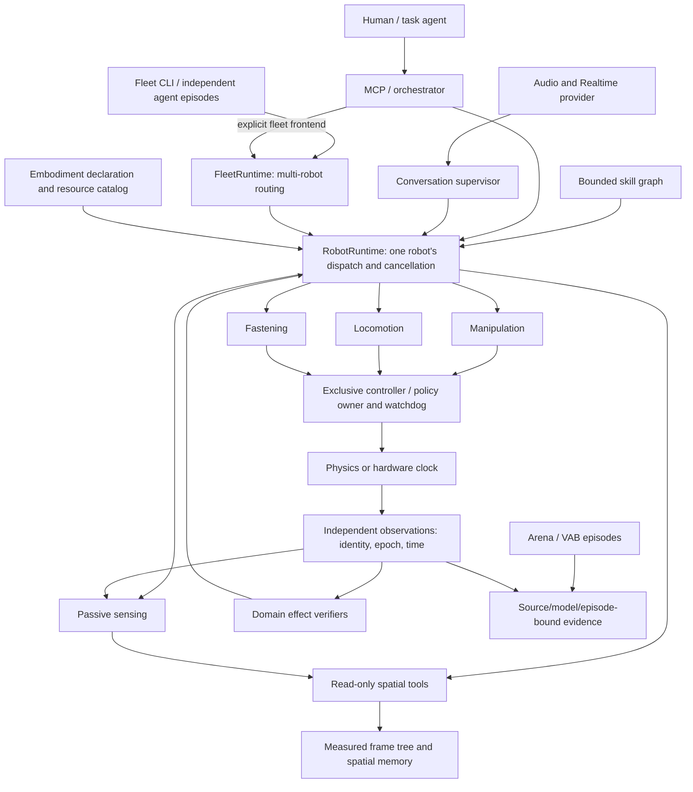

# Composable robots, observations and validation

**Next action:** run the composed software path on mocks (about 1 min; `--extra kinematics`
brings pinocchio for the SO-101 mock arm, `--extra dev` pytest):

```bash
uv run --extra kinematics python -m cascade.apps.demo --robot mixed_mock --llm mock --no-view --no-serve
CASCADE_ROBOT=mixed_mock uv run --extra kinematics python -m cascade.apps.mcp_server   # stdio: waits for a client; Ctrl+C
uv run --extra kinematics python -m cascade.apps.skill_graph --robot mixed_mock \
  --graph configs/graphs/inspect_sensors.json --run-dir /tmp/cascade-graph-review
uv run --extra dev --extra kinematics pytest tests/test_robot_contracts.py tests/test_robot_runtime.py \
  tests/test_robot_mcp.py tests/test_skill_graph.py tests/test_sensing*.py \
  tests/test_vab*.py tests/test_arena*.py -q
```

`mixed_mock` uses mock actuators and a synthetic IMU; the graph example reads one synthetic IMU
capture into `graph-result.json` (not locomotion evidence). Composed domain runs get separate
directories and learned-store defaults; explicit store env overrides still win.

This page describes interfaces; physical results live in the [capability status](ROADMAP.md).
Existing arm and mobile entrypoints stay available next to the opt-in composed runtime. Passive
multi-DoF observations do not admit whole-body control, and mixed physical actuation stays
refused. `mobile_manipulator_mock` composes a mock arm on a mock base under the explicit
[whole-body contract](#multi-domain-embodiments-mounted-arms): software evidence, not admission.

## Architecture and the implemented boundary

Robot identity is not a class hierarchy of arm, duck and humanoid. A profile declares domains and
resources, and the coordinator registers the tools those domains implement, so perception,
locomotion, manipulation and touch evolve independently behind the same runtime, MCP, traces and
memory. Isaac Sim, MuJoCo and hardware drivers are backend adapters behind shared contracts;
MicroDuck's policy and actuator model do not define locomotion for every robot.

[](assets/architecture.svg)

[Download PNG](assets/architecture.png). Dashed boxes mark work still in progress.



Solid arrows are existing interfaces, not admission of every combination. The optional shared
MicroDuck backend owns one scene for up to twelve robots (one solve, separate identities;
[foundation checks](evidence/microduck-shared-20261004/foundation.json) passed with 1, 2 and 12
robots); its [endpoint candidate](MICRODUCK.md#shared-scene-implementation-boundary) passed 1- and
2-robot native episodes, while twelve-robot execution failed its unchanged feedback progress limit.
Independent agent motion, collision coordination and physical per-robot/global stop still need
native validation.

| Module | Implemented responsibility | Deliberate boundary |
| --- | --- | --- |
| `robotics/contracts.py`, `resources.py`, `embodiment.py` | Immutable tools/resources, joint/link/transmission and sensor declarations, static controller ownership | Declarations never connect a lazy actuator, supply measured transforms or certify a robot |
| `robotics/runtime.py` | Namespaced dispatch, global stop latch, generation invalidation, domain lifecycle; per-domain latches and an explicit per-domain `reset_stop(domain=...)` for whole-body profiles | Domain controllers retain transport leases, physical timing and safety |
| `robotics/whole_body.py` | Opt-in whole-body contract: disjoint command endpoints, a capture-time `world ← base ← arm_base` frame chain, `exclusive`/`concurrent` coordination and world-frame verdicts with the frame valid at command start | Mock compositions only; a declared mount is not a calibration; no whole-body controller, balance, self-collision or moving-frame arm limits |
| `apps/robot_runtime.py` | Explicit manipulation, locomotion, fastening, sensing and spatial composition through `--robot` / `CASCADE_ROBOT`; a manipulation domain `mounted_on` a locomotion base under a `whole_body` contract | Mixed physical actuation is refused; whole-body compositions with any physical actuating resource are refused with the missing gates named |
| `conversation/`, `apps/conversation.py` | Browser media, Realtime provider, allowlisted semantic intents, deadlines and priority interruption ([CONVERSATION](CONVERSATION.md)) | Supervisor above one robot runtime; no joint writer, implicit stop reset or hosted-service deployment |
| `sensing/` | Typed passive observations, provenance, freshness, bounded readers/history | Reading cannot step physics or claim actuator ownership |
| `spatial/` | Capture-time frame lookup, source-bound memory, synthetic route proposals, observed RGB-D annotations, an optional [cuVSLAM RGB-D provider](SPATIAL_PROVIDERS.md#optional-cuvslam-localization) and an opt-in [`go_to` route runner](SPATIAL_PROVIDERS.md#opt-in-observed-route-execution) (`spatial/navigation.py`) | cuVSLAM has CPU contract coverage, a 12-frame native synthetic RGB-D replay and a [live native simulation stream](SPATIAL_PROVIDERS.md#live-native-rgb-d-stream) of 12 tracked captures, with uncalibrated pose uncertainty; `go_to` has CPU tests only and no shipped provider; physical localization and native route execution remain pending; annotations are not a collision map |
| `control/microduck_policy.py`, `sim/microduck_stepper.py` | Pinned ONNX contract and physics-clock policy application | Robot-specific implementation; no generic humanoid policy loader or second writer to head joints |
| `robotics/graph.py` | Immutable bounded DAG of registered skills, outcome and data edges | No graph-generated code, online self-editing or automatic stop reset |
| `eval/vab.py`, `eval/arena.py`, `eval/trials.py` | Optional external API adapters and bound independent verdicts | Upstream success alone does not grant physical admission |
| `robotics/fleet.py`, `apps/fleet.py`, `apps/fleet_mcp.py` | Concurrent task routing, an independent agent episode per robot, and bounded fleet MCP with per-robot/global stop | Native independent agent motion and shared-space collision coordination remain pending |
| `sim/microduck_shared.py`, `sim/microduck_shared_native.py`, `sim/microduck_admission.py` | One scene solve and native channel capture, staged independent policies, detached robot observations and opt-in TCP endpoints | Native 1/2-robot zero-command endpoint lifecycle passed; 12-robot execution hit its feedback progress limit. Gait, physical stop and peer motion remain pending |

## Capability boundaries

| Capability | Present in the code | Still required |
| --- | --- | --- |
| Talk and understand tool intents | Local browser/provider/session path with bounded audio and curated tools | Reliable general dialogue, hardware audio and public service operation |
| Interact with objects | Arm skills, SafeArm, grasp/release observations, optional cuMotion and OVRTX; a mock arm mounted on a mock base with world-frame reach verdicts (B30) | Validation for each body/tool/scene; physical whole-body mobile manipulation (measured mount calibration, independent base pose, moving-frame arm limits) |
| Turn a fastener | Mounted Factory domain with per-solve observations and final rest checks | Repeatability of the measured mounted turn/rest episode; acquisition, engagement, withdrawal and calibrated preload |
| Walk or turn | MicroDuck MobileBase, pinned policy, BAM, command leases and independent support/rest checks; the [Unitree H2 PhysX candidate](HUMANOID_H2.md) on the same `MobileBase`/`SafeBase`/verifier path (simulation only) | General gait, longer paths, physical admission and other robot/model/controller combinations |
| Perceive and remember space | Passive sensors, measured-frame contracts, retained RGB-D surface annotations, optional cuVSLAM localization (uncalibrated) and an opt-in `go_to` route runner (CPU tests only) | Calibrated physical SLAM/localization, a collision map from the robot's own sensors, metric reconstruction admission and native execution of planned routes |
| Describe different bodies | Fixed/floating roots, links, transmissions and typed scalar/generalized joint observations; explicit multi-domain embodiments with disjoint command endpoints and a capture-time mount frame chain (mock) | Drivers and control mappings for each mechanism; dynamic whole-body control, balance and arm physics on a moving base (e.g. Unitree H2 arms) |
| Sense touch | Contact, estimated-force and tactile-image contracts | Calibrated tactile device drivers and task-specific tactile verification |
| Coordinate twelve robots | Concurrent fleet runtime, agent CLI/MCP and one shared native scene; separate identities and zero-command support measured for twelve robots | Resolve measured feedback latency, then validate independent native agent tasks, collision interaction and physical fleet stop/reset |

Runtime rules every composition keeps:

1. `ResourceDescriptor.admission` (e.g. `unvalidated`, `software_only`) is declared metadata, not a
   certificate. Keep declaration, software execution and physical evidence distinct; a fleet's
   aggregate success never promotes another robot's unverified result.
2. The agent clock chooses goals; the controller clock applies bounded actions and watchdogs
   (MicroDuck: 5 ms physics, policy every four solves; rendering and LLM latency add no solves).
   Speech never writes policy-owned joints. Rebind these per robot.
3. Tools are namespaced (`manipulation.open_gripper`, `locomotion.get_base_state`,
   `sensing.read_sensor`); discovery, stop, explicit stop reset and task completion stay global. A
   profile without an arm advertises no arm. Configuration is explicit: no import-scanning plugin
   discovery that could initialize hardware while listing tools.
4. The ownership unit is the **command endpoint**, not a joint subset (the Unitree arm driver
   publishes a whole `LowCmd`, so disjoint joint names can still interfere). The catalog rejects
   multiple writers for one controller; this does not replace cross-process admission.
5. Stop invalidates dispatch before waiting for transport IO, with at most one stop worker and one
   pending request per domain, so a blocked transport cannot block another domain's stop. Reset is
   refused while stop IO is pending; a late motion result is invalidated. A stop receipt is not
   proof of rest; biped controllers must keep their own balance-preserving stop.

### Independent robot fleets

`robotics.fleet.FleetRuntime` composes configured `RobotRuntime`s by explicit robot ID.
`execute(robot_id, tool, arguments)` routes each member's unchanged catalog; robots act
concurrently while each keeps its own gate, generation, verification debt, memory and trace.
Duplicate identities, shared state or store files and conflicting controller endpoints are refused.
`stop(robot_id)` targets one member; `stop()` invalidates all with a shared 0.5 s receipt deadline
(a blocked RPC cannot hold up the others); only an explicit per-robot `reset_stop` restores
dispatch. The fleet API creates no physical scene (the shared MicroDuck backend does).

```bash
uv run python -m cascade.apps.fleet --fleet microduck_mock12 --llm mock \
  --task "inspect and move briefly" --run-dir runs/fleet-example
uv run python -m cascade.apps.fleet_mcp --fleet microduck_mock12 \
  --run-dir runs/fleet-mcp-example --max-pending 64
```

1. `apps.fleet` runs one `AgentOrchestrator` episode per robot (separate clients, histories and
   evidence; `--llm mock` is a labelled scripted diagnostic, not a model deciding to walk).
   `--fleet` also takes a YAML file (`version: 1`, `robots`, `deadline_s`, `max_workers`,
   `max_steps`; per robot `profile`, optional `config_dir` and `task`; `mock_id` only for unmounted
   mock mobile fixtures). The whole resource graph is checked before any robot is built; no
   simulator or model server is launched.
2. `FleetAgents.stop(robot_id)` cancels one agent; `stop()` and SIGINT/SIGTERM cancel all. The
   episode generation and deadline fence every tool call; in-flight HTTP is reported pending.
   `catalog.json`, per-robot traces and `report.json` keep assignments and outcomes. Use a new run
   directory per episode.
3. `cascade-fleet-mcp` (`apps.fleet_mcp`) speaks newline-delimited JSON-RPC on stdio:
   `fleet.catalog`, `fleet.execute` (`{robot_id, episode_id, tool, arguments}`), `fleet.stop`
   (`{robot_id}` or `{}`), `fleet.reset_stop({robot_id})` (a new explicit operator request;
   `CASCADE_HIDE_TOOLS=reset_stop` hides and rejects it; stops are never hideable; a robot behind
   the humanoid safety gate refuses it, and a fleet of only such robots does not list it: only a
   server restart clears their stop). The host owns conversations and inference.
4. Stops, cancellations and keepalives bypass ordinary work; cancelling queued or running motion
   latches that robot's stop. `max_workers` bounds concurrency, `--max-pending` queued plus running
   work (default 64, max 128; over capacity is rejected without actuation); input frames are capped
   at 256 KiB; EOF and signals fence the whole fleet; `mcp-report.json` records closure.
5. Software tests cover child-process stdio, twelve synthetic robots, per-robot stop during blocked
   work with an unaffected peer, capacity refusal, stale reset rejection and SIGTERM. Shared-scene
   physics and physical collision/stop are not covered.

## Multi-domain embodiments: mounted arms

B30, implemented with mocks (8 October 2026). Without a `whole_body:` block every earlier refusal
(more than one physical actuating domain, any `mounted_on`), tool schema and reset rule is
unchanged. With it, a profile composes a locomotion base and a manipulation arm mounted on it:

```yaml
version: 1
robot_id: mobile-manipulator-mock
whole_body:
  version: 1
  coordination: exclusive        # default; `concurrent` is an explicit opt-in
  max_mount_drift_m: 0.005       # world-frame postcondition tolerances
  max_mount_drift_rad: 0.01
  world_target_tolerance_m: 0.01
  # max_base_pose_age_s: optional; may only TIGHTEN the base profile's
  # safety.max_state_age_s, which is the default
domains:
  locomotion: {kind: locomotion, bases: [microduck_mock]}
  manipulation:
    kind: manipulation
    offline: true
    arms: [mock]
    cameras: [mock]
    mounted_on:
      domain: locomotion
      base: microduck_mock
      translation_m: [0.05, 0.0, 0.10]
      rotation_wxyz: [0.7071067811865476, 0.0, 0.0, 0.7071067811865476]
      calibration_id: mobile_manipulator_mock/declared-mount-v1
```

| Element | Contract | Fails closed when |
| --- | --- | --- |
| Domains and endpoints | Every actuating domain is a locomotion domain or a manipulation domain mounted on one. Each command endpoint (`controller_id`) belongs to exactly one domain; disjoint joint subsets are not disjoint endpoints | Two domains claim one endpoint (the error names both claimants and the endpoint); a fastening, hand or unmounted arm domain joins the contract; a mounted domain declares several arms or a static table `base_pose` |
| Mount and dynamic frames | `world ← base` is the base state at its capture time (`received_monotonic_s − producer_age_s`, base epoch); `base ← arm_base` is the declared mount. Lookups use the spatial `FrameTree`: bounded zero-order hold, never extrapolation | The base pose is missing, unreadable, from another epoch, older than `max_base_pose_age_s`, out of order (older than a sample already seen), conflicting (two poses for one capture time), `fallen`, or its controller reports `fault`/`disabled`: every mounted-arm motion is refused before arm IO |
| Coordination | `exclusive` (default): mounted-arm motion requires the base controller to report `ready` (no active command) and no locomotion operation in flight; locomotion motion requires that no mounted arm has a motion in flight (harness motion flag). `concurrent` (opt-in) lifts only these two vetoes | `RobotRuntime` still admits one ordinary tool call at a time. Concurrency never relaxes the frame requirement or the world-frame verdict |
| Stop and reset | `emergency_stop` latches every domain (unchanged). `reset_stop` requires `domain`; only that domain's controller is reset and only its motion is re-admitted | `reset_stop` without a domain is refused; a failed or raced domain reset re-latches every domain |
| World-frame postconditions | Every mounted-arm motion records the frame valid at command start and re-reads the base pose after the command. `manipulation.reach_world_point` resolves its world target once with the start frame, solves IK in the arm base frame and checks the achieved TCP in world with that same frame | Mount drift beyond tolerance refutes the outcome (downgrading `ok`, keeping `self_reported_ok`); a missing, stale or re-epoched end frame leaves it `unverified`; synthetic channels (kinematic mock base or arm) can refute but never confirm |
| Physical admission | Not admitted. A whole-body composition with any physical actuating resource is refused and the error names the missing gates | Always, until a measured mount calibration, an independent base-pose source, moving-frame arm limits and a validated whole-body controller with balance-preserving stop exist |

Mounted domains add two composition tools of `robotics/whole_body.py` (not `TOOL_SPECS` skills, so
README skill counts are unchanged): `manipulation.get_arm_world_pose` (read) and
`manipulation.reach_world_point` (one IK solve keeping the tool orientation plus one harness-vetted
`move_joints` through `SafeArm`; refused while holding an object; no grasping, carrying or path
planning). Profile: `configs/robots/mobile_manipulator_mock.yaml` (`--robot
mobile_manipulator_mock` / `CASCADE_ROBOT=mobile_manipulator_mock`).

1. `get_arm_world_pose` reports the TCP only when the lazy arm is already connected; it never
   powers an arm to answer.
2. The frame chain reads the base's own validated state (`passive_state`, as
   `locomotion.get_base_state`); an independent base-pose source is an admission gate, not an input.
3. A latched base reports `ready`, so after a global stop the arm can be reset and used while the
   base stays latched; resetting the base is a separate call.
4. Over MCP, `reset_stop` without `domain` and the argument-free SIGUSR1 staff reset are refused for
   whole-body profiles; the server stop latch clears only when no domain remains latched.
5. Navigation bindings are refused for whole-body compositions (a second, asynchronous base writer).

Measured (software only, `tests/test_whole_body_domains.py`, 43 tests): endpoint-overlap refusal;
after a 4 cm base walk the arm-base pose equals base ∘ mount and a world target is re-expressed and
reached within 1 mm; stale and missing base poses refuse before the lazy arm connects; both
coordination policies; per-domain reset and re-latch; golden digests of all 15 earlier robot
profiles. Not claimed: physical whole-body control, balance, H2 arm physics, arm/base
self-collision, world collision for the mounted arm or a calibrated mount.

## Observation and policy contracts

1. An observation carries sensor/source identity, schema, epoch, sequence, capture time, clock
   domain, local receipt time, producer age, measurement kind and model identity; payloads add
   frame, units, calibration and saturation. The hub rejects replay, stale data, changed epochs and
   mismatched identities, bounds providers, bytes and history, and quarantines a timed-out reader.
2. Kinds: IMU, proprioception, solved contact, estimated tactile force, tactile image, RGB, RGB-D. A
   force estimate is not a solver reaction or foot-support proof; missing data stays unknown, never
   zero. Legacy camera data is BGR and depth metric. Mobile providers read independent truth/frame
   endpoints without opening the actor connection or stepping the simulation.
3. The tactile registry and payloads exist; a humanoid tactile driver, calibration and verifier do
   not. The opt-in [camera-only RGB-D path](SPATIAL_PROVIDERS.md#camera-only-rgb-d-domain-mobile_rgbd)
   connects the native mobile producer to sensing/MCP without an arm (software-tested).
4. Injected providers are trusted integration code, not sandboxed; production providers must show
   passive behavior and independent clocks.
5. A future policy adapter must bind joint and observation ordering, units, frames, normalization,
   history, action representation, limits, rate/decimation, model hash and the exclusive
   controller; there is no generic policy loader. MicroDuck keeps its audited 61-observation /
   14-action contract.

### Capture-time alignment (B50, opt-in)

`read_sensor` returns each sensor's latest capture independently (a camera read at step 10 then an
IMU read returns steps 10 and 11, silently). An `alignment:` block in a sensors domain adds the
read-only tool `read_aligned` (absent: the catalog is byte-identical):

```yaml
sensing:
  kind: sensors
  alignment:
    max_skew_s: 0.02          # required, (0, 1] s; the bound is inclusive
    max_rotation_rad: 0.02    # optional
    max_translation_m: 0.005  # optional
  providers: [...]
```

`sensing.read_aligned(reference="overview", sensor_ids=["imu", "joints"])` (default: every other
sensor) reads ONE fresh reference capture (a failed or repeated read refuses the call), reads each
paired sensor once (a refusal is reported as `read_error`) and pairs it with the admitted capture
nearest the reference time (`src/cascade/sensing/alignment.py`):

1. Only the same clock domain and epoch are compared by skew (the process-local `monotonic` domain
   is shared across epochs).
2. `aligned`: |skew| ≤ `max_skew_s`.
3. `uncertain` (returned, flagged): `clock_not_comparable` (latest capture younger than the
   sensor's `max_age_s`), `saturated`, or `motion_exceeds_tolerance` (measured rate × |skew| above
   the declared tolerance; a first-order estimate, not a bound).
4. `stale` (withheld; sequence, epoch, capture time, skew and SHA-256 reported): |skew| >
   `max_skew_s` or an incomparable capture older than `max_age_s`. `missing`: no admitted capture.
5. Nothing is interpolated or extrapolated: a returned observation is one admitted capture byte for
   byte (`capture_sha256`), ties keep the earlier capture, unmeasured channels are listed as
   `absent`. B39's link self-mask uses the same buffer and classification.

Measured in software (`tests/test_proprio_time_alignment.py`, 42 tests, real loopback mobile bridge
through MCP): a step-10 capture pairs with step-11 IMU at +5 ms (aligned under 7.5 ms), a step-14
capture finds only step 11 (stale, withheld). Not claimed: a fusion estimator, native Isaac skew,
hardware clock sync, accuracy of the motion estimate.

### Producer-rate sampling (B72, opt-in)

Without it, `read_aligned` pairs only among captures that reads admitted, so skew depends on when
the caller reads. `producer_history` adds every sample the producer recorded at publication:

```yaml
sensing:
  kind: sensors
  alignment:
    max_skew_s: 0.0075
    producer_history: 64      # optional, 1..256 samples kept per paired sensor
  providers: [...]
```

1. The mobile bridge (`MobileBridgeController(state_history=N)`, CLI `--state-history N`, 1..256)
   keeps its last N completed states as `state` would serve them, advertises `state_history` in
   `hello` and serves `state_history(after_step)` copies (a new epoch empties it; without the option
   the operation is refused). In process: `BufferedSensorProvider(descriptor, history=N)`.
2. `BaseTruthReader.history` checks the advertised bound, epoch, identities and strictly advancing
   steps and physics times; every age includes the round trip.
3. The hub admits each fetch through the sensor's own bounded worker, deadline and quarantine; a
   violating batch is refused whole; per-sensor rings are bounded by `producer_history` and
   `max_history_bytes`, separate from the shared read history (a large RGB-D capture cannot evict
   IMU samples).
4. Pairing reports `from_producer` and the policy `producer_history`; a history fetch refusal is
   reported as `producer_error`; classification is B50's. Without the key the output is
   byte-identical (golden digest).
5. Measured in software (`tests/test_producer_rate_alignment.py`, 60 tests): with 200 Hz IMU/joints
   all 48 pairings aligned at 0 ms vs 12 of 48 with read-time sampling. Not claimed: native Isaac
   skew, fusion, hardware sync, history through `--state-reader process` (it refuses
   `state_history`, so pairing falls back to read time), a `--state-history` flag on the H2 owner,
   RGB/RGB-D producer history.

## Research directions and external benchmarks

| Primary source and inspected revision | Transfer to CASCADE |
| --- | --- |
| [ros2_control ResourceManager](https://github.com/ros-controls/ros2_control/blob/ed2a6ea169172d3bfe08e2c7bf6ca9dea5e10767/hardware_interface/include/hardware_interface/resource_manager.hpp) and [controller chaining](https://control.ros.org/rolling/doc/ros2_control/controller_manager/doc/controller_chaining.html) | Resource claims, coordinated mode changes and explicit command ownership; joint lists alone are insufficient |
| [ROS 2 lifecycle](https://design.ros2.org/articles/node_lifecycle.html) | Configuration, activation and teardown have different meanings from cancelling a task or maintaining balance |
| [Isaac Lab manager environment](https://github.com/isaac-sim/IsaacLab/blob/2c9c4df629ee0c553fbba432721b6e7caeda4b08/source/isaaclab/isaaclab/envs/manager_based_env.py) | Policy processing and physics substep application belong to the controller clock, independent of LLM latency |
| [Isaac ROS G1 GR00T integration](https://nvidia-isaac-ros.github.io/v/release-4.6/repositories_and_packages/isaac_ros_physical_ai/isaac_ros_unitree_g1_gr00t/index.html) | Upper-body task actions and lower-body balance are distinct responsibilities; stopping must respect their coordination |
| [GR00T data configuration](https://github.com/NVIDIA/Isaac-GR00T/blob/51d4c89f72fda44cbf77285c6a8114b52676b8a1/getting_started/data_config.md) | Bind modality ordering, action representations and temporal horizons, not only tensor dimensions |
| [LeRobot robot interface](https://github.com/huggingface/lerobot/blob/ff71cae1ae2d09fd035553c35da65888ed6c8304/src/lerobot/robots/robot.py) | Reusable robot/observation adapters; retain separate CASCADE cancellation and independent verification |
| [Isaac Lab contact semantics](https://isaac-sim.github.io/IsaacLab/v3.0.0-EA/source/concepts/sensors/contact_sensor.html) and [TacSL sensor APIs](https://isaac-sim.github.io/IsaacLab/main/source/api/lab_contrib/isaaclab_contrib.sensors.html) | Declare backend force semantics, contact-pair coverage and estimated versus solved forces explicitly |
| [DORA dataflow](https://github.com/dora-rs/dora/blob/b2df5ec2be1fc0f2755eca80316c679e94132283/guide/src/concepts/dataflow-yaml.md) | Bounded queues and transport separation are useful optional infrastructure; transport is not authority to command actuators |
| [ROS4HRI standard](https://ros4hri.github.io/standard.html) | Human interaction can be a separate typed domain. Speech produces bounded intent, not joint targets |
| [Reachy conversation app](https://github.com/pollen-robotics/reachy_mini_conversation_app/tree/5ab905d018de8d88f07444ca57677b2ffbe762ca), [HF speech-to-speech](https://github.com/huggingface/speech-to-speech/tree/411399d34555b2169823a6eaeb7f8ff192db89db) | Realtime conversation separate from motion; implemented as the [conversation supervisor](CONVERSATION.md). Reachy's head poses cannot drive policy-owned MicroDuck joints |

1. **Graph-as-policy** ([GaP, arXiv:2607.05369v1](https://arxiv.org/html/2607.05369v1)): CASCADE has
   the execution substrate only. `robotics/graph.py` validates the whole immutable graph before
   dispatch, hashes graph and catalog, calls the same `runtime.execute()` as MCP, routes every motion
   through `confirmed`/`refuted`/`unverified`/`error` (reads: `success`/`error`), schema-checks
   `$result` references from dominating nodes, and is acyclic and bounded in steps and time.
   Cancellation requests priority stop; reports keep `physical_admission: false`. Not GaP's
   learning harness.
2. **VAB and Arena**: adapters target the public
   [VAB](https://github.com/ehehee/Variational-Automation-Benchmark) at
   `edcc4bf005446839c0c6f43f8a3bf416702af030` (VABAR names no public API; GaP vendors
   `fd2bc0f63369ba39137df018bbca8f6b372ffa0b`) and
   [Isaac Lab Arena](https://github.com/isaac-sim/IsaacLab-Arena) at
   `c8d04e2199b86abbbb301bb22cec0effd83c4e63`. The
   [source inspection](evidence/robot-modularity/vab-source-inspection.json) found 62 task YAMLs and
   3,052 initial states; the adapter accepts 40 manifests. Upstream success is kept as
   `benchmark_success` and CASCADE checks physical behavior separately (some VAB tasks teleport
   objects or check only the last stage); VAB needs an explicit reviewed runtime factory.
3. Independent verdicts bind the exact artifact, configuration, model, epoch, physical window and
   snapshots; missing or mismatched evidence stays unverified; a verifier callback is a trusted
   measurement boundary. Arena's `source_revision` is caller-selected, not attested.
4. Native preflights (VAB CPU Panda relative motion and cancellation; Arena PhysX observation and
   cancellation) are in [the benchmark adapter guide](../benchmark/arena/README.md); no benchmark
   task completed and task/stop verdicts stay unverified. Simulator dependencies stay optional and
   isolated.
5. Software validation receipts: [full run](evidence/robot-modularity/software-validation.json)
   (5,178 passed; three mobile stop tests exceeded loopback deadlines),
   [CI follow-up](evidence/robot-modularity/ci-followup.json),
   [macOS late-read fix](evidence/robot-modularity/macos-late-read-fix.json).

## Admission work for an actual humanoid

The next physical vertical must select one real embodiment and controller,
rather than assert support for all humanoids at once. The embodiment selected
on 7 October 2026 is the Unitree H2 on PhysX ([HUMANOID_H2.md](HUMANOID_H2.md)):
gate 1 (binding) passed in simulation on 7 October 2026, gate 2 is partially
shown and gate 5 has a first simulation pass ([gate table](HUMANOID_H2.md#admission-gates-robot_modularitymd--admission-work-for-an-actual-humanoid));
nothing is admitted physically. Required work includes:

1. Bind the model, policy, command endpoint and all observation/action mappings;
   demonstrate exclusive ownership and controller-clock execution.
2. Measure dynamic transforms with epochs and freshness. Replace static arm
   workspace/extrinsic assumptions before enabling mobile manipulation.
3. Validate whole-body limits, balance, self/environment collision and contact
   coordination. Independent per-domain success is insufficient when moving
   the base changes reachability or support.
4. Calibrate each added sensor and define missing, stale, saturated and degraded
   behavior. Validate tactile evidence against task-specific physical measures.
5. Rehearse balance, gait, turns, loaded manipulation, stop, disconnect, reset
   and sensor loss through the real MCP/controller/physics/verifier route.
   Arena can organize variation; independent measurements and video must bind
   to the same episode. Physical deployment requires its own staged validation.

MicroDuck's historical short-distance passes sit beside retained failed commands
([MICRODUCK](MICRODUCK.md)); they establish neither general walking, twelve-robot operation nor
admission of a later source/model combination.

## Declared embodiment (`embodiment:`)

An optional `embodiment` section in `configs/robots/*.yaml` declares links,
joints (`loop_closure: true` for loop constraints), transmissions and sensor
attachments. `list_resources` returns it with `embodiment_sha256`
(`robotics/embodiment.py`); an absent section changes nothing.

## Fixed LEAP hand (`leap_hand_right_mujoco`)

`configs/robots/leap_hand_right_mujoco.yaml` exposes 16 finger joints through
`hand.get_hand_state`, `hand.move_fingers` and `hand.set_hand_posture`
(`skills/hand_runtime.py`). It covers bounded free finger motion only: no grasp,
tactile calibration, moving wrist or hardware.
